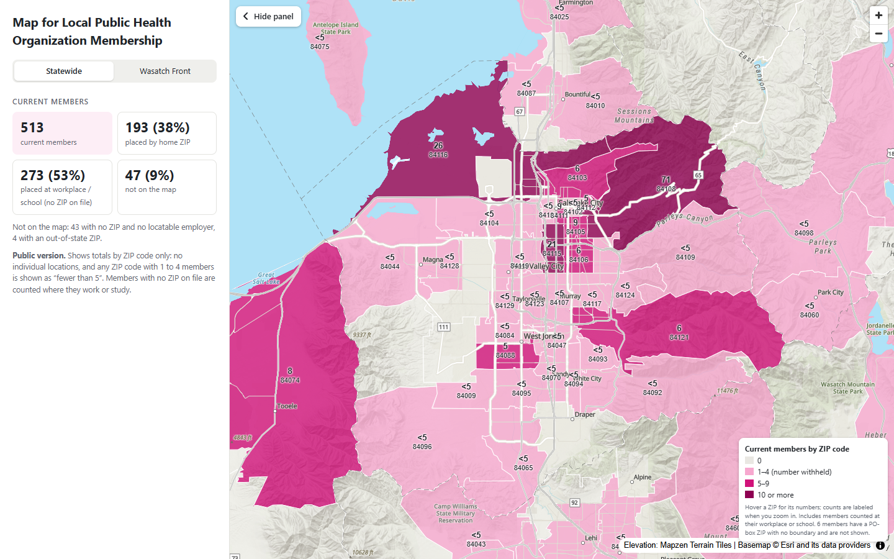
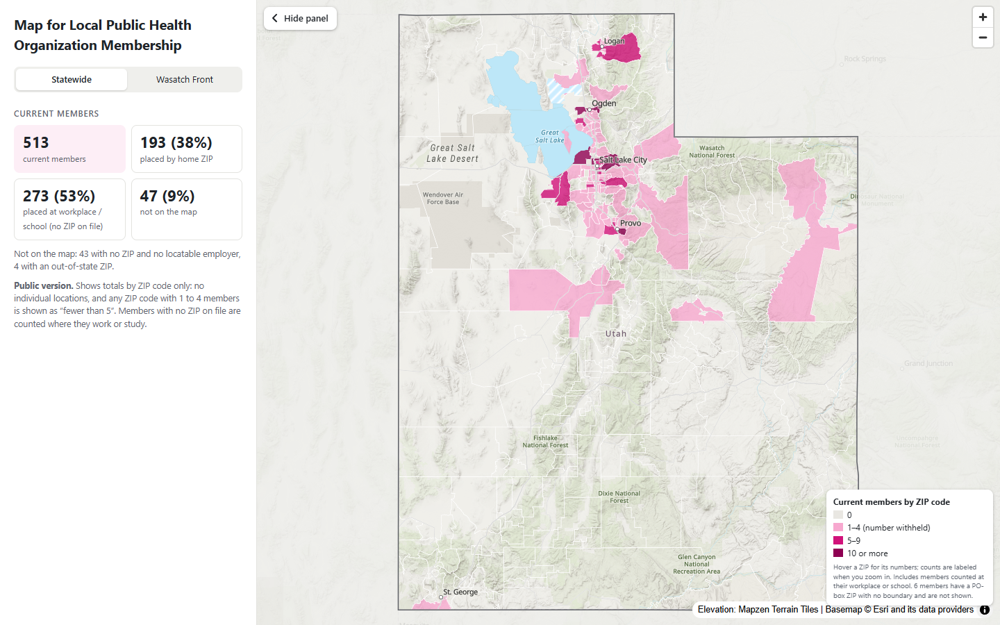

# Map for Local Public Health Organization Membership

An interactive map of where a local public health organization's members are across Utah, built so its
board can see which parts of the state the organization reaches and where it is under-represented.

**[Open the public map →](https://izhodson.github.io/public-health-membership-map/)** (ZIP-code totals only)




## What I built
- **Data pipeline (Python, GeoPandas, Shapely):** cleans a raw membership export, decides who is a current,
  former or pending member, locates members by ZIP code (with fallbacks to city boundaries and to employer or
  school locations), and aggregates them to ZIP codes, counties and local health districts with population rates.
- **Interactive web map (MapLibre GL JS):** one self-contained HTML page with hover readouts, count labels that
  appear as you zoom, a vector topographic basemap with hill shading, and everything outside Utah washed out.
- **Two builds from one codebase:** a full internal map for the organization's board and a public,
  aggregate-only map (the link above).
- **Internal analysis views** (not published): a dot-density view, county rates per 10,000 residents, and the
  number of members *expected* in each county if membership followed population (total members × the county's
  share of Utah's population), to show which counties are over- or under-represented.
- **Reference data automation:** boundaries, populations and lakes are pulled from Utah's open GIS data (UGRC SGID).

## Handling member data responsibly
The source is a real membership list, so the project is built so that no individual, and not the
organization itself, can be identified from anything published:
- **Member files never leave the machine.** The raw export, the cleaned data, the employer lookup, the
  internal map and all preview images are git-ignored; none of them are in this repository.
- **No addresses are used.** The export has no street addresses, and the cleaning script drops any address
  column if a future export has one. The finest location is the ZIP code.
- **The public map is aggregate only.** It shows current members per ZIP code, with no individual dots, no
  counties, no workplace names, and no former or pending members. Its data is built by whitelisting fields in
  `public_data()` (`scripts/05_build_web_map.py`), so nothing new is published by default.
- **Small counts are suppressed.** Any ZIP code with 1–4 members shows only "fewer than 5". The exact small
  numbers are removed in Python before the page is written, so they are not hidden in the page's source either.
- **The organization is not named.** Its name and file names live in a git-ignored settings file
  (`data/private/org.json`, read by `scripts/org_settings.py`); without it, the code uses generic names.
- **Even the internal dot map protects location.** Each dot is placed at a random spot within the member's
  ZIP code (and off lakes), never at a real home, and the legend says so.

## Layout
- `scripts/`: the pipeline, the web page template and `org_settings.py`.
- `docs/`: the public map (`index.html`, served by GitHub Pages) and README screenshots.
- Not in the repository (git-ignored): `data/raw/` (member export, contains PII), `data/processed/` (cleaned
  members and map layers), `data/private/` (organization names), `data/reference/` (boundary data, downloaded by
  `01_fetch_reference.py`, and the hand-maintained employer lookup `company_locations.csv`), `outputs/`
  (internal map and preview images).

## Who counts as a member
Set in `scripts/02_clean_members.py` (`member_group`), judged as of `AS_OF`:
- **current**: today falls between `joined_date` and `expiration_date`, **or** `status` is Active
  (lifetime and many student/individual memberships have no expiration date).
- **former**: Expired or Cancelled, and not current.
- **pending**: Pending/Prospective. These have no location in the export and are reported in stats only.

When a new export arrives, update `AS_OF` in `02_clean_members.py` and `05_build_web_map.py`.

## Location method
The export has only city / ZIP / state, and only some rows have them, so members are located at the
**ZIP level**:
- `members_zip_points`: every member stacked at their ZIP's interior point (used for counts).
- `members_dots` (internal map only): each member placed at a random spot inside their ZIP, preferring the town
  portion of the ZIP and never on or within 150 m of a lake, reservoir or marsh (fixed seed).
  **These are not real home locations.**
- ZIPs without a boundary polygon (PO-box / unique ZIPs) fall back to the city's municipal boundary.
- Out-of-state ZIPs are kept in the cleaned data but left off the maps.
- **Current members with no ZIP are placed at their employer or school** using the hand-maintained lookup
  `data/reference/company_locations.csv` (company name as exported -> org, town, ZIP, lat/lon). They are counted
  separately (`n_current_work`) and show where members work or study, not where they live. On the internal dot
  map, workplaces with more than 3 members get a dashed outline around their dots; smaller groups are plain dots.

## Map design choices
- **ZIP codes**: every ZIP area shaded by member count (0, 1–4, 5–9, 10+ on the public map). ZIPs have no
  population in the reference data, so this is a count, not a rate; large rural ZIPs look prominent with only a
  few members. Hover a ZIP for its numbers; counts are labeled from zoom 9.
- **Background**: Esri World Topographic Map (vector tiles) with hill shading computed in the browser from free
  Mapzen/AWS elevation tiles; everything outside Utah is washed out and Utah's border is drawn on top.
- **Internal map only**: Dots, ZIP codes and Counties views; Current / Former / Both and a workplace toggle; a
  Counties tab with members per 10,000 residents, expected members by population and a county table. Counties
  with fewer than 5 members are faded because those rates are unreliable.

## Pipeline
Run from the project root (Python 3.12; `pip install -r requirements.txt`). Steps 02–05 need the member
export, `company_locations.csv` and optionally `data/private/org.json`, which are not in the repository.
```
python scripts/01_fetch_reference.py      # UGRC boundaries + lakes -> data/reference/utah_reference.gpkg
python scripts/02_clean_members.py        # export -> data/processed/members_clean.csv
python scripts/03_build_member_layers.py  # -> data/processed/members.gpkg (points + ZIP/county/LHD/HSSA counts)
python scripts/04_preview_maps.py         # -> outputs/maps/preview_*.png
python scripts/05_build_web_map.py        # -> outputs/web/ (internal map) + docs/index.html (public map)
```
After rebuilding, check `git status` before committing: only `docs/` should change, never `data/` or `outputs/`.

All layers use EPSG:26912 (NAD83 / UTM 12N). Count layers have `n_members`, `n_current`, `n_current_work` and
`n_former`; county and health-district layers also have rates per 10,000 residents (population from UGRC
`POP_CURRESTIMATE`).

## Data sources
- Member export: not included (aggregate counts as of October 5, 2026)
- Utah boundaries, populations and lakes: https://gis.utah.gov (SGID)
